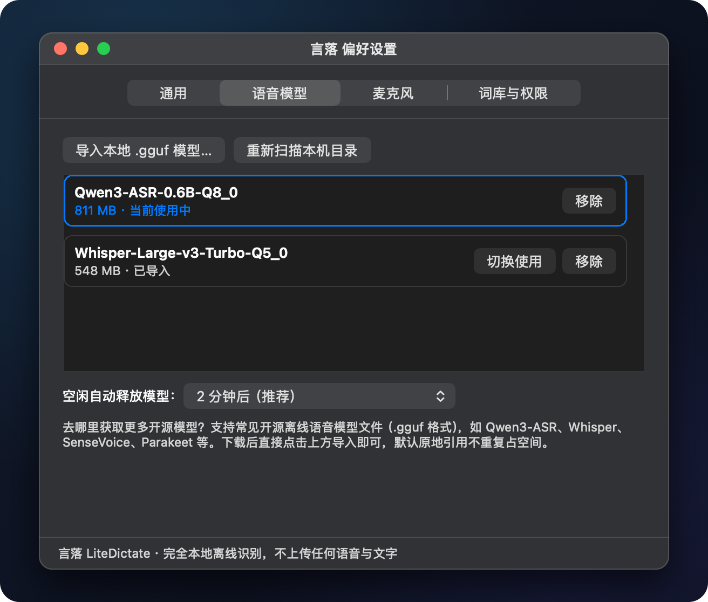
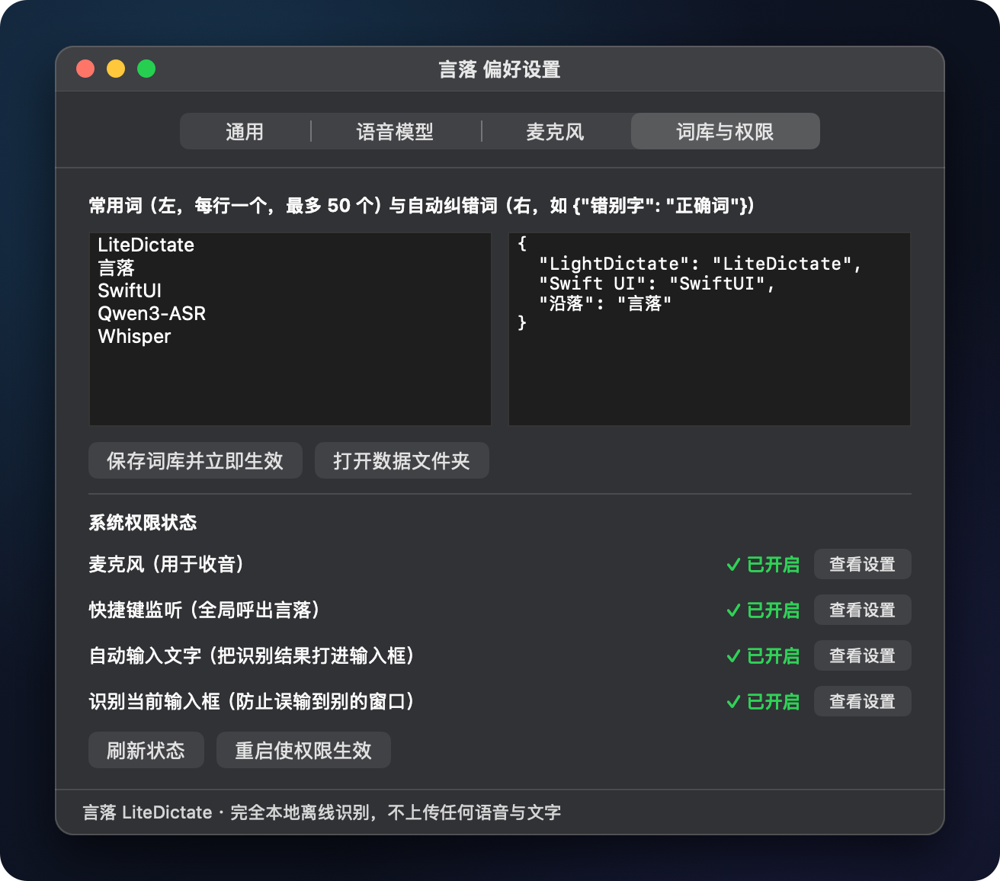

<div align="center">


<h1>LiteDictate · 言落</h1>

<p>纯原生、完全离线的 macOS 菜单栏语音输入工具</p>

<p>
  <a href="https://github.com/MiohalationM/LiteDictate/releases/latest">
    
  </a>
  
  
  
  
</p>

<p>
  <a href="https://github.com/MiohalationM/LiteDictate/releases/latest"><strong>下载 DMG 安装包</strong></a>
  &nbsp;·&nbsp;
  <a href="#界面预览">界面预览</a>
  &nbsp;·&nbsp;
  <a href="#快速开始">快速开始</a>
  &nbsp;·&nbsp;
  <a href="CHANGELOG.md">更新日志</a>
  &nbsp;·&nbsp;
  <a href="README_EN.md">English</a>
</p>

<br />


</div>

---

## 核心特性

- **极轻常驻，8 GB 内存友好**
  纯 AppKit 原生编写，无 Electron / SwiftUI / WebView 运行时。待命时常驻内存仅 **~13 MB**、CPU **0%**；语音模型运行在独立子进程中，空闲自动卸载（支持自定义立即释放 / 1 / 2 / 5 分钟 / 常驻），遇到系统内存紧张或锁屏休眠时立即回收。
- **直接输入，不破坏剪贴板**
  内置三层自适应文本注入管线（原生 AX → 受保护瞬时快照 → Unicode 键击），在 Safari、Chrome、Electron、微信、终端、JetBrains 等窗口稳定输入，不覆盖原剪贴板内容；零拷贝绕开 1Password 密码、文件承诺与大体积音视频。
- **单修饰键按住说话与防误触**
  默认按住 **右 `⌘`** 说话、松开落字。内置 `130 ms` 防组合键误触保护，正常使用 `右 ⌘ + C/V/Tab` 绝不误触发；说话期间随时按 `Esc` 即可取消。支持在偏好设置中自定义任意单修饰键（`右 ⌘`、`右 ⌥`、`Fn` 等）或组合键（`⌘⇧D`、`⌥Space` 等）。
- **无打扰轻提示与最近 5 条记录**
  未选中输入框、切换应用或位于密码框时，不再弹出阻断式弹窗，而是自动复制到剪贴板并在底部展示 2.5 秒自动消失的轻提示胶囊。菜单栏保留最近 5 条识别记录，纯内存暂存、0 落盘、0 日志，锁屏或退出立即清空。
- **戴蓝牙耳机不降音质**
  智能选择麦克风优先使用外接或电脑内置麦，戴 AirPods 等蓝牙耳机听歌或开会时说话不会切入低音质 HFP 通话模式。
- **100% 本地离线，自带开源模型**
  全程断网可用，语音与文字不上传云端。基于 `transcribe.cpp` + Metal GPU 加速，自由导入本地 `.gguf` 语音识别模型（支持 Qwen3-ASR、Whisper、SenseVoice、Parakeet 等），支持常用词表与自动纠错映射。

---

## 界面预览

<table>
  <tr>
    <td align="center" width="50%">
      
      <br />
      <sub><strong>通用与快捷键</strong> · 支持单修饰键 / 组合键自定义与预设一键切换</sub>
    </td>
    <td align="center" width="50%">
      
      <br />
      <sub><strong>语音模型管理</strong> · 原地引用本地 .gguf，自由配置空闲自动释放策略</sub>
    </td>
  </tr>
  <tr>
    <td align="center" colspan="2">
      
      <br />
      <sub><strong>常用词库与权限面板</strong> · 专业术语提示、自动纠错映射与一站式系统权限引导</sub>
    </td>
  </tr>
</table>

---

## 实测资源占用

测试环境：Apple M1 · 8 GB 统一内存 · macOS 14+ · 模型 `Qwen3-ASR-0.6B-Q8_0.gguf`（850 MB）。

| 状态 | 进程 | 物理内存足迹 (`phys_footprint`) | CPU / 耗时 |
| :--- | :--- | :---: | :---: |
| **日常待命（Idle）** | `LiteDictateApp`（无 Worker） | **`13 MB`** | CPU `0.0%` |
| **模型热待机** | `litedictate-worker`（`mmap` + Metal） | **`82 MB`** | 冷加载 `0.90 s` |
| **本地推理（2s 音频）** | `litedictate-worker` | `87 MB`（峰值 `313 MB`） | 推理 `0.23 s` |
| **空闲到期 / 锁屏后** | `LiteDictateApp` | **`13 MB`** | Worker 自动退出 |

> 按住快捷键开始说话的瞬间即在后台并行预热模型，正常说话超过 0.9 秒时松手几乎无感出字。

---

## 快速开始

1. 前往 [Releases](https://github.com/MiohalationM/LiteDictate/releases/latest) 下载 `LiteDictate-1.1.0-arm64.dmg`，打开后将 **LiteDictate** 拖入「应用程序」。
2. 启动后点击顶部菜单栏图标，按引导授予**麦克风**、**辅助功能**与**输入监控**权限，并导入一个本地 `.gguf` 语音模型（如 `Qwen3-ASR-0.6B-Q8_0.gguf` 或 `ggml-large-v3-turbo`）。
3. 在任意输入框中**按住右 `⌘`** 说话，松开即自动输入；随时按 `Esc` 取消。

> **首次打开提示**：若因未公证遇到 macOS 提示“无法验证开发者”，在终端执行一次以下命令即可：
> ```bash
> xattr -cr /Applications/LiteDictate.app
> ```

---

## 开发者从源码编译

<details>
<summary>展开编译与打包命令（Apple Silicon / macOS 14+ / Xcode 16+ / CMake）</summary>

```bash
git clone https://github.com/MiohalationM/LiteDictate.git
cd LiteDictate

# 1. 拉取并校验 SHA-256 的 transcribe.cpp v0.4.1 引擎动态库
./Scripts/fetch-transcribe-cpp.sh

# 2. 运行全部单元测试（严格控制 8 GB 内存并发上限）
swift test -j 2

# 3. 构建并签名 Release .app 与 .dmg 安装包
JOBS=2 ./Scripts/build-app.sh
./Scripts/build-dmg.sh
```

构建产物输出在 `Build/LiteDictate.app`、`Build/LiteDictate-1.1.0-arm64.dmg` 与 `Build/SHA256SUMS.txt`。

</details>

---

## 隐私与开源协议

- **零联网、零遥测、零落盘**：所有音频 PCM、转写结果与最近 5 条历史均仅驻留内存，不写入磁盘或系统日志；锁屏、休眠与退出时立即清零。
- 基于 **MIT License** 开源，详见 [LICENSE](LICENSE) 与 [THIRD_PARTY_NOTICES.md](THIRD_PARTY_NOTICES.md)。
