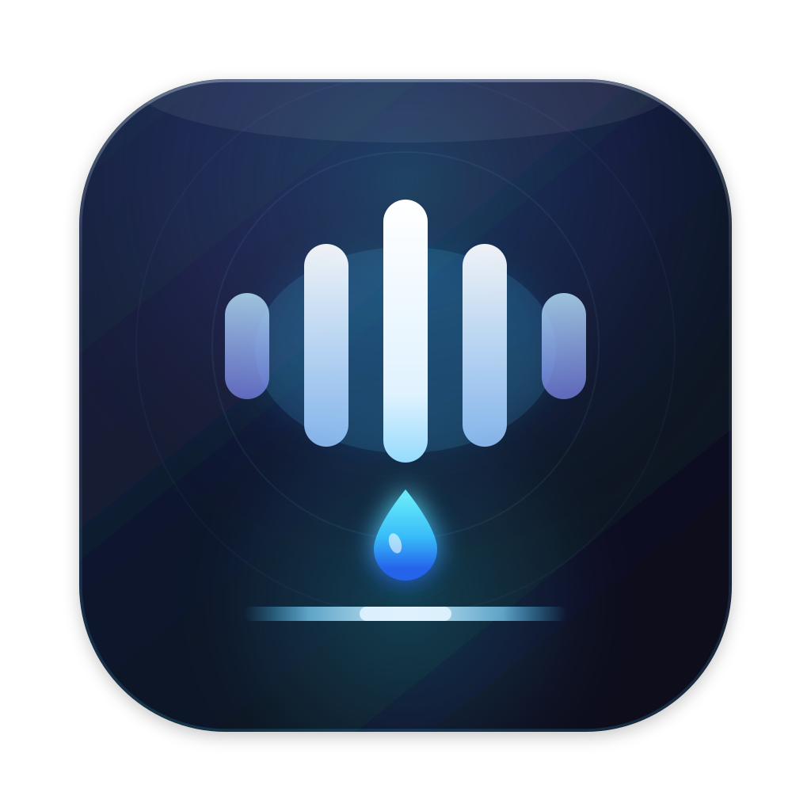

<p align="center">
  
</p>

<h1 align="center">LiteDictate（言落）</h1>

<p align="center">
  一款极轻、完全离线的 macOS 语音输入工具，说完字就出来。
</p>

<p align="center">
  
  
  
  
</p>

<p align="center">
  <a href="https://github.com/MiohalationM/LiteDictate/releases">下载安装包</a> ·
  <a href="README_EN.md">English</a> ·
  <a href="CHANGELOG.md">更新记录</a>
</p>

## 为什么用言落

- **说完字就出来，不占剪贴板**：识别出的文字直接打进当前输入框，不覆盖剪贴板里复制的图片或内容。
- **极轻不卡电脑**：平时挂在菜单栏只占约 **13 MB** 内存；识别完自动释放模型，不说话时不占多余内存和电量。
- **戴蓝牙耳机不降音质**：自动避开蓝牙通话模式，听歌、开会时按快捷键说话也不会变糊。
- **本地离线、模型自由**：全程断网可用，语音和文字不上传云端；可自己导入 `.gguf` 离线语音模型（支持 Qwen3-ASR、Whisper、SenseVoice 等）。

## 快速使用

1. 前往 [Releases](https://github.com/MiohalationM/LiteDictate/releases) 下载 `LiteDictate-1.0.0-arm64.dmg`，打开后拖入「应用程序」。
2. 点击顶部菜单栏图标，按提示开启所需权限，并导入一个本地 `.gguf` 语音模型。
3. 在任意输入框按 `⌘⇧D` 开始说话，再按一次结束出字，随时按 `Esc` 取消。

## 常见小贴士

- 首次打开如遇到系统安全提示，在终端运行一次：`xattr -cr /Applications/LiteDictate.app`。
- 可在菜单栏「偏好设置」里改快捷键、开关机自启、切换按住说话，或添加常用词与自动纠错。
- <details><summary>开发者从源码编译（Apple Silicon / macOS 14+）</summary>

```bash
git clone https://github.com/MiohalationM/LiteDictate.git && cd LiteDictate
./Scripts/fetch-transcribe-cpp.sh
JOBS=2 ./Scripts/build-app.sh
./Scripts/build-dmg.sh
```

</details>

## 开源协议

基于 MIT 协议开源，详见 [LICENSE](LICENSE)。
