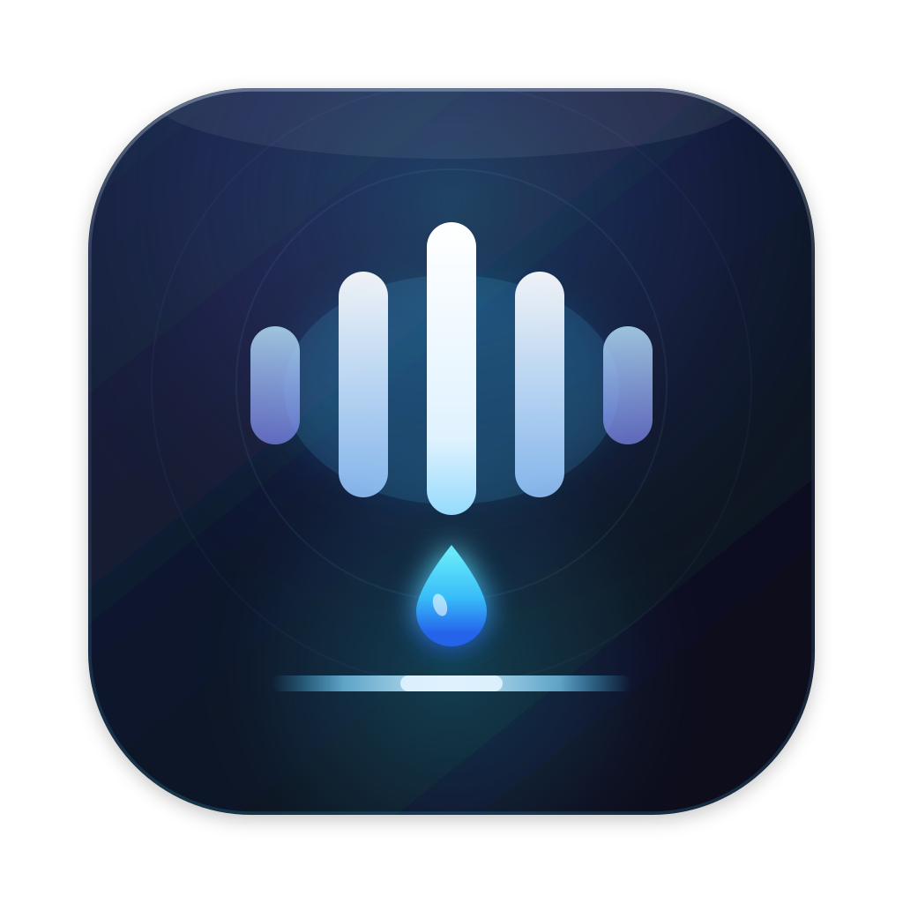
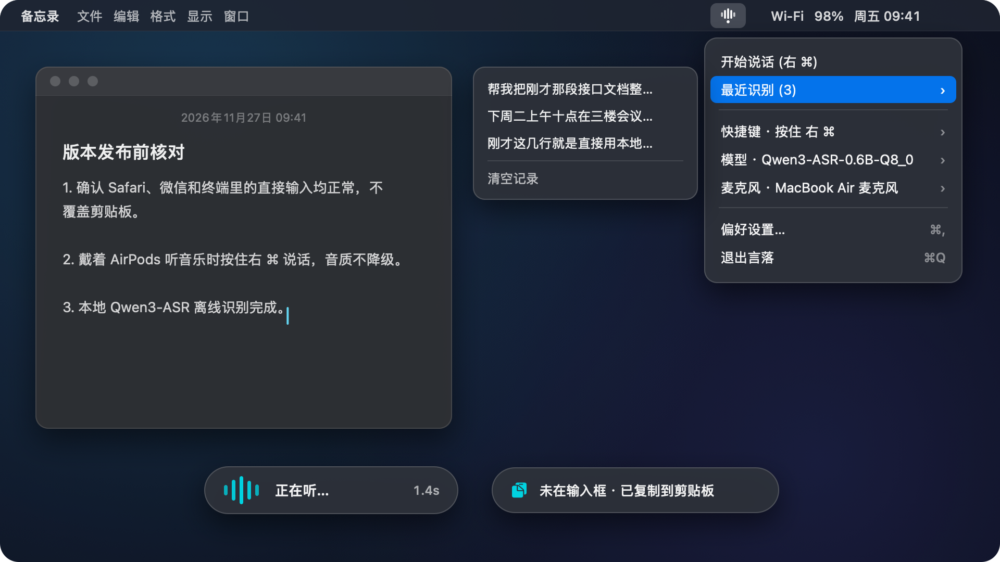
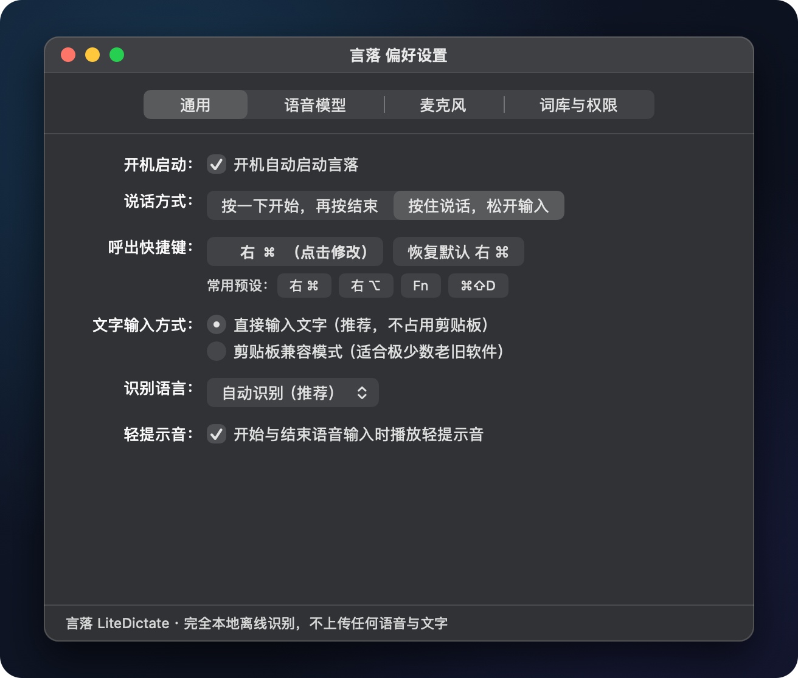
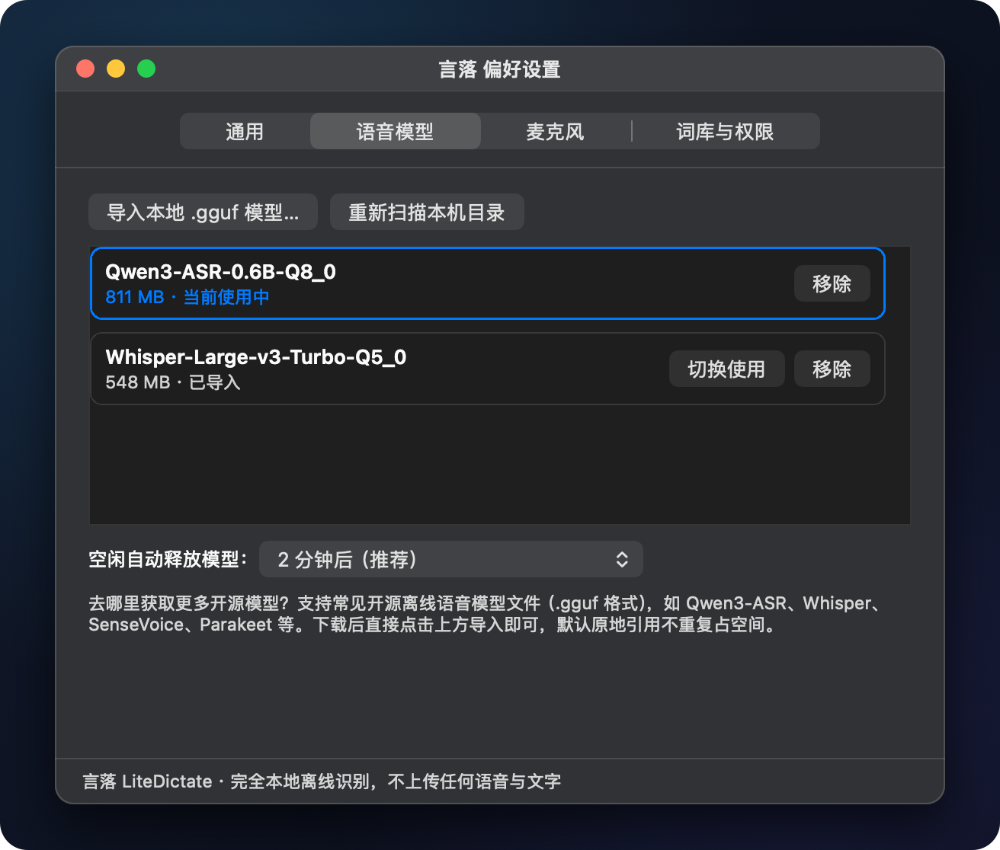
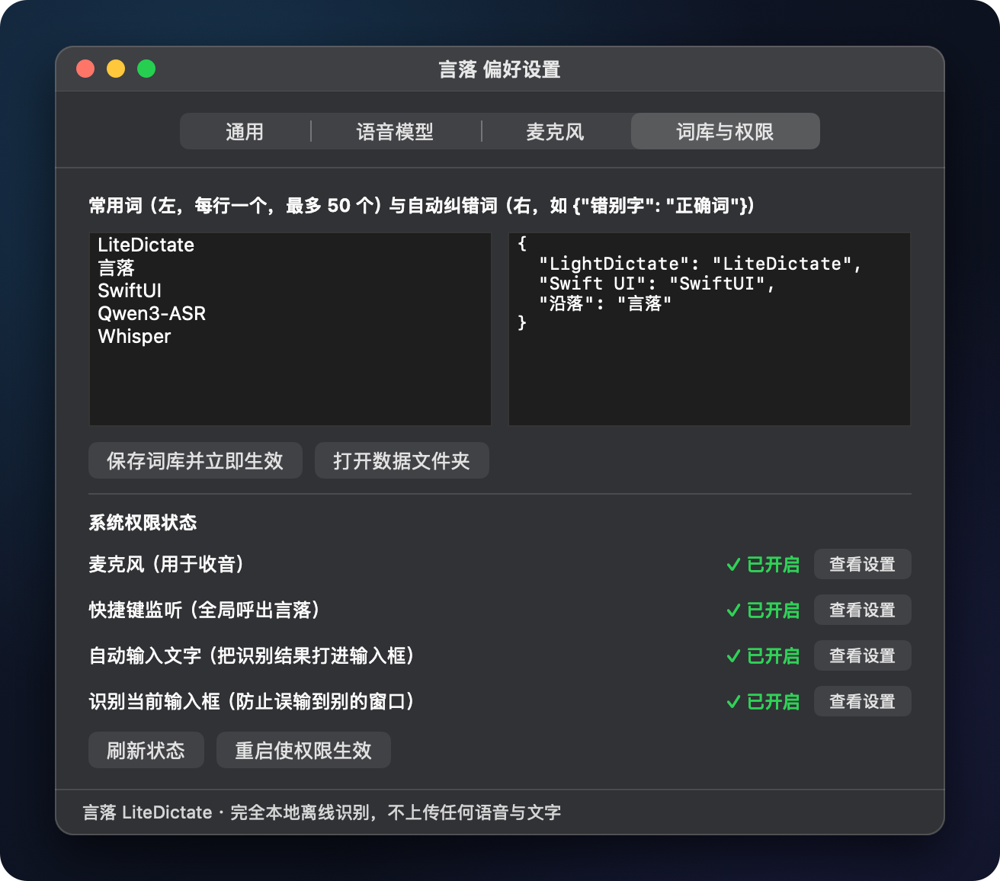

<div align="center">



<h1>LiteDictate · 言落</h1>

<p>A native, 100% offline macOS menu bar voice dictation app built for Apple Silicon</p>

<p>
  <a href="https://github.com/MiohalationM/LiteDictate/releases/latest">
    
  </a>
  
  
  
  
</p>

<p>
  <a href="https://github.com/MiohalationM/LiteDictate/releases/latest"><strong>Download DMG</strong></a>
  &nbsp;·&nbsp;
  <a href="#screenshots">Screenshots</a>
  &nbsp;·&nbsp;
  <a href="#quick-start">Quick Start</a>
  &nbsp;·&nbsp;
  <a href="CHANGELOG.md">Changelog</a>
  &nbsp;·&nbsp;
  <a href="README.md">简体中文</a>
</p>

<br />



</div>

---

## Highlights

- **Featherweight Native AppKit (~13 MB Idle)**
  No Electron, WebView, or SwiftUI runtime. Idles at **~13 MB** physical memory and **0% CPU**. Speech inference runs in an isolated worker process that auto-unloads when idle (configurable: immediately / 1 / 2 / 5 min / resident) and immediately reclaims memory on macOS memory pressure or screen lock.
- **Direct Text Injection Without Clobbering Your Clipboard**
  Three-tier adaptive insertion pipeline (Verified AX → Protected transient snapshot → Unicode keystrokes) works across Safari, Chrome, Electron, WeChat, Terminals, and JetBrains IDEs while keeping your clipboard intact and zero-copy blocking 1Password concealed items, file promises, and streaming media.
- **Single-Modifier Push-to-Talk with Chord Guard**
  Hold **Right `⌘`** to speak and release to insert text. A `130 ms` chord guard keeps `Right ⌘ + C/V/Tab` completely untouched, and pressing `Esc` while holding cancels immediately. Record any custom single-modifier key (`Right ⌘`, `Right ⌥`, `Fn`, etc.) or combo (`⌘⇧D`, `⌥Space`) in Preferences.
- **Non-Intrusive Auto-Copy Toast & 5-Item In-Memory History**
  When no text field is focused, you switch apps, or Secure Input is active, LiteDictate automatically copies the transcript and shows a 2.5-second bottom toast instead of blocking modal popups. Keeps up to 5 recent transcripts in RAM only (zero disk writes, zero logs, wiped on lock/sleep/quit).
- **No Muffled Bluetooth Headphones**
  Smart microphone selection prefers external or built-in mics so listening to music or joining calls on AirPods never drops into low-bitrate HFP call mode.
- **100% Offline, Bring Your Own GGUF Model**
  Powered by `transcribe.cpp` with Metal GPU acceleration. Import any local `.gguf` speech model (Qwen3-ASR, Whisper, SenseVoice, Parakeet, etc.) by reference without duplicating files, plus custom vocabulary and alias rules.

---

## Screenshots

<table>
  <tr>
    <td align="center" width="50%">
      
      <br />
      <sub><strong>General & Shortcuts</strong> · Single-modifier & combo recorder with 1-click presets</sub>
    </td>
    <td align="center" width="50%">
      
      <br />
      <sub><strong>Offline Models</strong> · Zero-copy local .gguf imports & configurable idle memory release</sub>
    </td>
  </tr>
  <tr>
    <td align="center" colspan="2">
      
      <br />
      <sub><strong>Dictionary & Permissions</strong> · Custom vocabulary, auto-corrections & guided TCC setup</sub>
    </td>
  </tr>
</table>

---

## Measured Footprint

Benchmarked on Apple M1 · 8 GB unified RAM · macOS 14+ · `Qwen3-ASR-0.6B-Q8_0.gguf` (850 MB).

| State | Process | Physical Footprint (`phys_footprint`) | CPU / Latency |
| :--- | :--- | :---: | :---: |
| **Idle** | `LiteDictateApp` (no worker) | **`13 MB`** | `0.0%` CPU |
| **Warm Model Standby** | `litedictate-worker` (`mmap` + Metal) | **`82 MB`** | `0.90 s` cold load |
| **Inference (2s audio)** | `litedictate-worker` | `87 MB` (peak `313 MB`) | `0.23 s` inference |
| **After Idle TTL / Lock** | `LiteDictateApp` | **`13 MB`** | Worker exits cleanly |

---

## Quick Start

1. Download `LiteDictate-1.1.0-arm64.dmg` from [Releases](https://github.com/MiohalationM/LiteDictate/releases/latest) and drag **LiteDictate** into **Applications**.
2. Click the menu bar icon to grant **Microphone**, **Accessibility**, and **Input Monitoring** permissions, then import a local `.gguf` speech model.
3. **Hold Right `⌘`** anywhere to speak and release to insert text (press `Esc` to cancel).

> **First launch**: If macOS Gatekeeper warns about an unnotarized open-source build, run once in Terminal:
> ```bash
> xattr -cr /Applications/LiteDictate.app
> ```

---

## Build from Source

<details>
<summary>Show build & packaging commands (Apple Silicon / macOS 14+ / Xcode 16+ / CMake)</summary>

```bash
git clone https://github.com/MiohalationM/LiteDictate.git
cd LiteDictate

./Scripts/fetch-transcribe-cpp.sh
swift test -j 2
JOBS=2 ./Scripts/build-app.sh
./Scripts/build-dmg.sh
```

Artifacts are written to `Build/LiteDictate.app`, `Build/LiteDictate-1.1.0-arm64.dmg`, and `Build/SHA256SUMS.txt`.

</details>

---

## Privacy & License

- **Zero network calls, zero telemetry, zero disk persistence** for audio or transcripts; all in-memory buffers and recent history are wiped on sleep, screen lock, or quit.
- Released under the **MIT License** — see [LICENSE](LICENSE) and [THIRD_PARTY_NOTICES.md](THIRD_PARTY_NOTICES.md).
