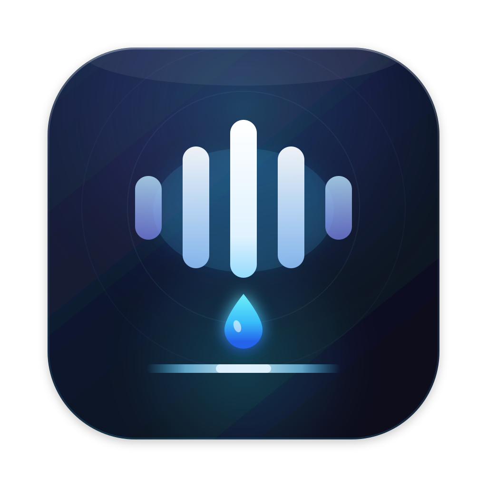

<p align="center">
  
</p>

<h1 align="center">LiteDictate（言落）</h1>

<p align="center">
  <strong>极轻纯原生 macOS 离线语音输入工具 —— 直接输入不占剪贴板、闲置仅 ~12.5 MB 内存、零蓝牙耳机降音质、自由导入任意 GGUF 模型。</strong>
</p>

<p align="center">
  
  
  
  
  
</p>

<p align="center">
  <a href="README.md">English README</a> ·
  <a href="https://github.com/MiohalationM/LiteDictate/releases">下载 v1.0.0 DMG 安装包</a> ·
  <a href="CHANGELOG.md">更新日志</a> ·
  <a href="CONTRIBUTING.md">参与贡献</a>
</p>

---

## 核心特性

- **直接输入文字，完全不碰剪贴板**：识别出的文字直接输入到当前光标处，绝不覆盖剪贴板里的图片、密码或文字，也不污染剪贴板历史；偏好设置中亦保留可选「剪贴板兼容模式」适配极少数老旧软件。
- **专为 8 GB 内存 Mac 深度打磨（闲置 ~12.5 MB，60 秒归零模型内存）**：
  - 100% 纯原生 **AppKit** 菜单栏与偏好设置窗口（零 Electron、零 SwiftUI、零 WebView），浮窗与设置窗关闭即彻底释放显存与视图。
  - 独立可销毁 C++17 `litedictate-worker` 子进程：每次识别完立刻释放计算图归还内存，闲置 60 秒或遇系统内存紧张直接退出，推理内存彻底归零（**0 MB**）。
  - 权限就绪后彻底关闭后台轮询定时器，静置待机 **0.00 次/秒** 无效唤醒、CPU 仅 **0.038%**。
- **戴蓝牙耳机听歌开会不降音质**：基于单输入 CoreAudio `AUHAL` 与**智能选择麦克风**（优先外接 USB/雷雳 > 电脑内置，自动跳过蓝牙耳机与虚拟声卡），说话绝不触发蓝牙通话模式（HFP）变糊；也支持在设置中自由指定任意麦克风，外接麦拔出自动回退、回插自动恢复。
- **自由导入任意开源 GGUF 语音模型**：支持 **Qwen3-ASR**、**Whisper**、**SenseVoice**、**FunASR-Nano**、**Parakeet**、**Moonshine**、**Voxtral**、**Granite Speech**、**Canary** 等开源离线语音模型；默认原地引用零额外占空间，也可一键复制到应用目录。
- **离线隐私与顺手细节**：
  - 100% 本地离线识别、零云端上传、零识别正文日志；输入完成、按 `Esc` 取消、锁屏、休眠或退出时立即清空内存音频。
  - 偏好设置内置可视化快捷键录制（默认 `⌘⇧D`，支持「按一下开关」与「按住说话」）、原生开机自动启动（`SMAppService`）、终端换行防误执行保护、密码框自动暂停、切换窗口时的恢复卡片与「复制上一次识别文字」防丢保护。

---

## Apple M1（8 GB 统一内存）实机测试数据

基于 **Apple M1 8 GB** 实机内核 `proc_pid_rusage` / `task_info(TASK_VM_INFO)` 实测（`LiteDictate v1.0.0` + `Qwen3-ASR-0.6B-Q8_0.gguf` 811 MiB，Metal GPU）：

| 指标 | 实机测得 | 说明 |
| :--- | :---: | :--- |
| 菜单栏主程序闲置 `phys_footprint` | **`12.50 MB`** | 纯 AppKit Release 构建，窗口按需创建、关闭即销毁 |
| 后台静置 CPU / 每秒包唤醒（10s 稳态） | **`0.038%` / `0.00 次/秒`** | 授权完成后停止周期轮询，零电量拖累 |
| 冷态闲置推理内存 | **`0 MB`** | 闲置 60 秒优雅退出（卸载仅需 **`29.9 ms`**） |
| 热待机 Worker `phys_footprint` | **`81 – 103 MB`** | 权重只读 `mmap` 映射，单次识别完立即释放计算图 |
| 活跃识别峰值 `phys_footprint` | **`310 – 330 MB`** | 识别结束瞬间释放临时计算图与 KV 缓存 |
| 语音转文字速度（Metal GPU） | **`3.5× – 13.3×` 实时** | 2–15 秒中英混说约 250 ms – 1.3 s 出字 |

---

## 安装与使用

### 方式一：直接下载 DMG 安装（推荐）

1. 前往 [GitHub Releases](https://github.com/MiohalationM/LiteDictate/releases) 下载 **`LiteDictate-1.0.0-arm64.dmg`**。
2. 打开 DMG，将 **LiteDictate** 拖入 **应用程序（Applications）** 文件夹。
3. 打开 **LiteDictate**（若使用未公证的本地签名构建，首次打开若遇系统拦截可执行一次 `xattr -cr /Applications/LiteDictate.app`）。
4. 点击顶部菜单栏声波图标 → **开启系统权限以开始使用…**，按引导开启麦克风、输入监控与辅助功能权限，并导入一个 `.gguf` 语音模型即可开始说话。

### 方式二：从源码本地编译（macOS 14.0+，Apple Silicon）

需要 Xcode Command Line Tools（Swift 6.0+）、CMake、Ninja：

```bash
git clone https://github.com/MiohalationM/LiteDictate.git
cd LiteDictate

# 1. 拉取并校验 SHA-256 签名后的 transcribe.cpp v0.4.1 动态库（不进入 Git）
./Scripts/fetch-transcribe-cpp.sh

# 2. 运行全部 Swift 单元测试（针对 8 GB 内存限制并发度）
swift test -j 2

# 3. 编译并签名 Release 版本 LiteDictate.app（自动检测本机证书，无证书时自动使用 ad-hoc 签名）
JOBS=2 ./Scripts/build-app.sh

# 4. （可选）打包美观的 LiteDictate-1.0.0-arm64.dmg 与 SHA256SUMS.txt
./Scripts/build-dmg.sh
```

---

## 自定义热词与纠错词库

可在 **偏好设置 → 词库与权限** 中直接编辑保存，或直接修改 `~/Library/Application Support/LiteDictate/` 下的文件：
- `vocab.txt`：每行一个热词（最多 50 词，按模型能力自动启用）
- `aliases.json`：自动纠错替换表（最长词优先，例如 `{"Swift UI": "SwiftUI", "LightDictate": "LiteDictate"}`）

## 开源协议

本项目基于 MIT 协议开源，详见 [LICENSE](LICENSE) 与 [THIRD_PARTY_NOTICES.md](THIRD_PARTY_NOTICES.md)。
